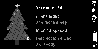

# Advent Calendar for BUSY Bar

A door a day until Christmas. Each December day has a door on the front display; **Start** opens it, with a chime and a golden light, to an animated pixel scene. On the back display a tree gains an ornament for every door you opened, and its star on Christmas Day.

   



## Using it

| Control | What it does |
|---|---|
| Start | Opens the door on show. On seven open doors it plays with the scene: shake the snow globe, ring the bells, stoke the fire, light up the tree, unwrap the gift, drop a present from the sleigh, wish on a shooting star. |
| Wheel | Browses doors 1 to 24 and Christmas Day. Later days are locked and say how long to wait; a missed day can be opened late. |
| OK | Back to today. |
| Back | Leaves the app. |

Before December the app counts the days to the first door. From 1 to 6 January every door stays open to look back on; the next season starts fresh. The Advent wreath behind door 5 burns a candle for every Advent Sunday so far.

### Settings

| Setting | |
|---|---|
| Sound when a door opens | On by default. |
| Test date | Real date, or 1 to 25 December: the app behaves exactly as on that day, and the back display says "Test date". For trying it before December. |
| Unlock every door | Any door opens at any time of year. |

The app reads its settings when it starts: start it again after a change.

## Building and running

Node 22 or later.

```sh
npm install
npm run build        # dist/io.kootstra.advent.tgz
npm run app:install  # onto a BUSY Bar connected over USB
npm run app:run
```

Without a BUSY Bar, [BUSY Bar Emulator](https://github.com/busy-app/busybar-emulator) runs it: `busy-emulator dev --once` from this folder.

```sh
npm test        # date rules, every frame of every scene, and the built app on a pretend bar
npm run sim     # previews/advent-simulator.html: the app in a browser, with a clock you can set
npm run bench   # how long the bar takes for a frame of every screen (needs the emulator running)
```

## How it is built

| File | |
|---|---|
| `src/main.js` | The app: input, which door is on show, one timer that paints and sends frames. |
| `src/calendar.js` | The date rules: the season, Advent Sundays, which doors are open, the stored record. No bar, no clock. |
| `src/scenes.js` | What is behind the 25 doors. |
| `src/scenery.js` | What scenes share: snow, stars, pines, houses. |
| `src/screens.js` | The doors, the opening, the countdown and the tree on the back display. |
| `src/canvas.js` | A 72x16 canvas of palette characters, sprites, a small font, and its XPM2 text for the bar. |
| `src/bar.js` | The calls to the bar's HTTP API. |

The bar runs JavaScript slowly: repainting the whole display on every frame gave 3 to 5 frames a second. A scene therefore paints what stands still once, and on each frame only what moves, on a copy of that backdrop. Animations follow the clock, not the number of frames drawn. A frame now takes about 60 ms, of which the bar's own display call is 45, and the app holds its 8 frames a second. [AGENTS.md](AGENTS.md) has the measurements and the rules that follow from them.

Tested on BUSY Bar Emulator with firmware 1.3.1.

## License

[MIT](LICENSE)
